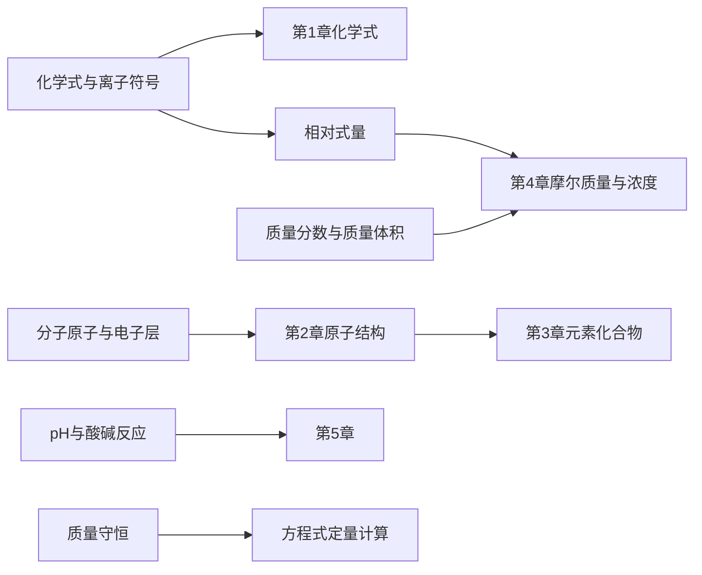

# 初中化学与《医用化学（第2版）》知识关联表（修订版）

本表把“知识重要性”和“补弱时机”分开。重要性高，只说明它影响后续学习；不表示第二节课必须补完。

重要性：

- 高：缺少它，对应章节的核心内容难以理解或计算。
- 中：对应章节可以在课堂中用较短时间补上。
- 低：现有教材主线联系弱。

补弱时机按教材实际出现的位置确定。

## 章节结构核实

三套资料的章节划分不相同，使用时分开看。

| 来源 | 核实结果 |
|---|---|
| 课件 | `01总资源\课件PPT` 有12个文件，对应第1–12章。第1–3章和第5–12章首页直接标有章名：绪论、物质结构、医药中常见的无机元素及其化合物、化学平衡与电解质溶液、有机化合物概述、烃、醇和酚、醛和酮、羧酸和脂类、糖类、氨基酸和蛋白质。第4章课件文件名为第四章，正文分“物质的量、溶液的浓度、溶液的渗透压”三节；教学大纲把这一单元称为“物质的量与溶液浓度”。没有第13章课件。 |
| 教学大纲图片 | `01总资源\教学大纲` 的课时表把实验列为“十三、实验”，共6学时。列出的项目是实验须知、实验1化学实验基本操作、实验2粗食盐的提纯、实验3溶液的配制。 |
| 教材正文 | 工作区没有教材PDF或纸质扫描件。ISBN 9787117313261的公开目录写有第十三章实验，与大纲一致；本次不能逐页核对正文是否把实验编成独立章。 |
| 进度表 | 进度表写了“第十三章 实验”，资料栏填的是课件或数字内容。文件夹里没有对应实验课件，这一栏与实际文件不符。 |

因此，原先写“第13章实验1、实验3”的依据是教学大纲图片，不是课件。下文改为“教学大纲中的实验单元”。

## 关联表

| 初中化学知识点 | 教材位置 | 具体内容 | 重要性 | 补弱时机 |
|---|---|---|---|---|
| 化学式的系数、下标 | 第1章化学式；第6–12章沿用 | 读懂2H₂O和后续分子式 | 高 | 进入第1章化学式内容前确认 |
| 化合价与离子化合物化学式 | 第1章化学式和化合价 | 由化合价写出组成 | 高 | 进入第1章化学式内容前确认 |
| 离子符号 | 第1章化学用语；第2章和第4章会继续使用 | Na⁺、Cl⁻等符号 | 高 | 与化学式一起，在第1章相关内容前确认 |
| 物质分类 | 第1章物质分类；第3、5章继续使用 | 单质、氧化物、酸、盐 | 中 | 第1章分类内容处随课确认 |
| 物理变化、化学变化 | 第1章物质的变化与性质 | 是否有新物质生成 | 中 | 第1章该节随课确认 |
| 分子、原子 | 第1章微粒回顾；第2章原子构成 | 化学变化中的最小粒子 | 高 | 进入第2章前确认 |
| 质子数与原子序数 | 第2章原子构成、元素周期表 | 质子数、核电荷数、原子序数 | 高 | 进入第2章前确认 |
| 电子层与离子形成 | 第2章核外电子排布 | 由最外层电子判断离子 | 高 | 进入第2章前确认 |
| 周期、族和递变规律 | 第2章元素周期律 | 主族性质递变 | 中 | 作为第2章新课学习，不提前系统复习 |
| 化学键、氢键 | 教学大纲把化学键与氢键列为第2章拓展 | 课件没有独立核心节 | 低 | 遇到拓展内容再处理 |
| 化学方程式配平 | 第1章反应类型；后续各章反应 | 原子个数守恒地书写方程式 | 高 | 第1章讲反应方程式时确认 |
| 基本反应类型 | 第1章化学反应的类型 | 化合、分解、置换、复分解 | 中 | 第1章该节确认；有机反应类型到第7章再学 |
| 质量守恒定律 | 第1章有独立表述 | 参加反应的物质质量总和等于生成物质量总和 | 中 | 独立评价。只在方程式定量计算处确认，不作为第4章物质的量、摩尔质量和浓度的前置条件 |
| 相对式量、相对分子质量 | 第4章摩尔质量 | 摩尔质量数值等于化学式量或相对分子质量 | 高 | 进入第4章前确认 |
| 溶质、溶剂、溶液 | 第4章浓度、配制和渗透 | 区分溶质与溶液 | 高 | 进入第4章前确认 |
| 溶质质量分数 | 第4章质量分数 | 溶质质量除以溶液质量 | 高 | 进入第4章前确认 |
| 质量与体积 | 第4章质量分数和质量浓度 | 质量分数使用质量，质量浓度使用g/L | 高 | 进入第4章前确认 |
| 物质的量、摩尔 | 第4章第一节 | 教材新内容 | — | 不列为初中补弱 |
| pH与酸碱性方向 | 第1章有回顾；第5章正式计算和应用 | 酸性、中性、碱性及pH变化 | 高 | 进入第5章前确认。第1章只要求能看懂定性结论 |
| 酸、盐与指示剂 | 第5章电解质、盐溶液和缓冲 | 酸性、石蕊、盐与酸的反应 | 高 | 进入第5章前确认 |
| 金属活动性顺序 | 第1章有回顾；第3章讲钠、钙、铝、铁、锌 | 判断金属与盐或酸能否反应 | 中 | 进入第3章前确认 |
| 空气、氧气、二氧化碳 | 第3章氧、氮及碳酸盐相关性质 | 支持燃烧、石灰水检验 | 中 | 进入第3章对应物质前确认 |
| 水的组成 | 第5章水的电离 | 电解水体积比只提供定性背景 | 中 | 进入第5章前按需要确认 |
| 实验安全与基本操作 | 教学大纲实验单元，不是课件中的第13章 | 浓硫酸稀释、闻气体、酒精灯 | 中 | 做大纲所列实验前确认 |
| 饱和溶液 | 第4章课件未见溶解度专节 | 暂未找到直接对应内容 | 低 | 遇到再处理 |
| 气体制取与收集 | 课件和大纲所列三个实验均未要求 | 暂未找到直接对应内容 | 低 | 不补 |
| 燃烧与灭火 | 第7章烷烃可燃性 | 新课会重新出现 | 低 | 第7章遇到再联系 |
| 化肥、材料、环境专题 | 第3章个别资料 | 铵盐、二氧化硫等散点 | 低 | 遇到再处理 |

## 依赖关系

两条关系不要并成一条。

第4章课件的顺序是：物质的量 → 摩尔质量 → n＝m/M → 物质的量浓度、质量浓度、质量分数和体积分数 → 稀释与配制 → 渗透压。

初中侧与它相连的是：

化学式 → 相对式量或化学式量 → 第4章摩尔质量 → 物质的量 → 物质的量浓度。

质量分数并列使用“溶质质量 / 溶液质量”，并要求不把体积直接当作质量。质量守恒不位于这条链上。

另一条是：

分子、原子、质子数和电子层 → 第2章原子结构与周期表 → 第3章元素化合物。

pH和酸碱反应连接到第5章。

