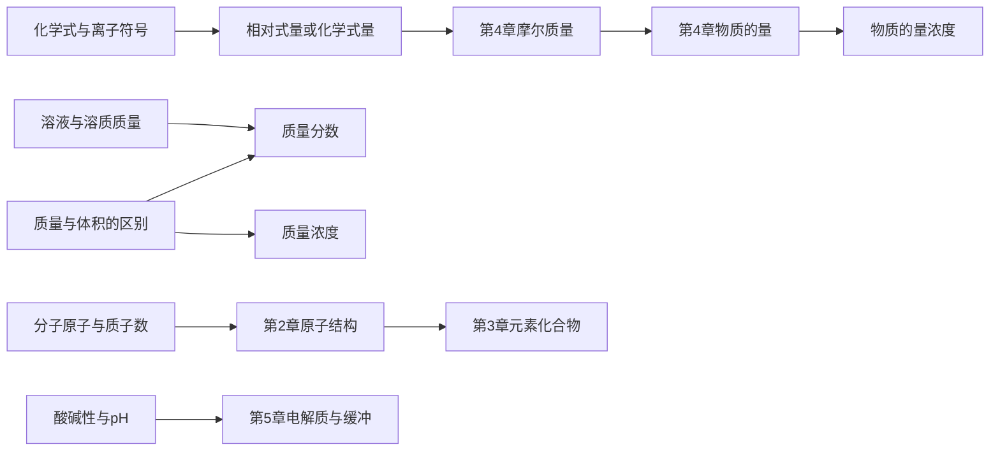

# 初中化学与《医用化学（第2版）》知识关联表

教材依据是12章课件、教学大纲图片和第4章原文，不是进度表的“高、中、低”标签。进度表目前把“掌握”全部标成考试重要性“高”，把“了解”全部标成“低”，不能作为考试证据。

关联标准：

- 高：缺少它就不能理解或计算后续核心内容。
- 中：有助于理解，后续课堂可以用较短时间补上。
- 低：教材联系弱，暂时不影响主线。

优先级：

- P0：进入第1章系统教学前需要确认，明显错误时第二节优先处理。
- P1：进入对应章节前补充。
- P2：遇到时再补，不安排专门复习课。

| 初中化学知识点 | 教材对应章节 | 对应教材具体知识点 | 关联程度 | 不掌握的影响 | 补弱优先级 |
|---|---|---|---|---|---|
| 物理变化、化学变化 | 第1章“物质的变化与性质” | 变化特征、质量守恒 | 中 | 影响第1章回顾，不阻断第4章计算 | P1 |
| 单质、氧化物、酸、碱、盐 | 第1章分类；第3章各类化合物；第5章电解质 | 物质类别与酸碱盐性质 | 高 | 无法判断NaCl、HCl、NaOH在后续反应中的类别 | P0 |
| 化学式中的系数和下标 | 第1章化学式；第6–12章分子式 | 2H₂O等符号含义 | 高 | 后续所有化学式都会读错 | P0 |
| 化合价与化学式书写 | 第1章化学式和化合价；第4章化学式量 | 由离子或化合价确定组成 | 高 | 式量和浓度失去计算对象 | P0 |
| 分子与原子 | 第1章微粒；第2章原子构成 | 原子是化学变化中的最小粒子 | 高 | 第2章原子结构缺少起点 | P0 |
| 质子数等于原子序数 | 第2章原子构成、元素周期表 | 核电荷数、质子数、原子序数 | 高 | 无法进入周期表编排 | P0 |
| 电子层与离子形成 | 第2章核外电子排布；第4章离子 | 最外层电子、Na⁺、Cl⁻ | 高 | 无法理解离子和盐溶液中的粒子 | P0 |
| 周期、族及性质递变 | 第2章元素周期律 | 主族递变、金属性与非金属性 | 中 | 第2章会重新教学；只需具备质子数和电子层前提 | P1 |
| 化学键、氢键 | 教学大纲列为第2章拓展 | 课件主线未展开成独立核心节 | 低 | 暂未构成主线前提 | P2 |
| 化学方程式配平 | 第1章反应类型；第3、7–12章性质反应 | 各类反应方程式 | 高 | 不能独立书写后续反应 | P0 |
| 四大基本反应类型 | 第1章“化学反应的类型” | 化合、分解、置换、复分解 | 中 | 有助于第1章；有机部分改用取代、加成等新类型 | P1 |
| 质量守恒定律 | 第1章原文；第4章质量关系 | 反应前后质量总和相等 | 高 | 方程式计算和溶液中溶质变化失去依据 | P0 |
| 相对原子质量、相对分子质量、相对式量 | 第4章摩尔质量 | 数值等于相对质量或化学式量，单位取g/mol | 高 | 无法由化学式得到摩尔质量 | P0 |
| 溶质、溶剂、溶液 | 第4章溶液浓度、配制和渗透 | 溶质B、溶液体积和质量 | 高 | 浓度公式中的对象会选错 | P0 |
| 溶质质量分数 | 第4章第二节质量分数 | 溶质质量与溶液质量相比，单位必须相同 | 高 | 无法完成质量分数及与其他浓度的换算 | P0 |
| 质量与体积的区别 | 第4章质量分数、质量浓度 | 质量分数用质量；质量浓度用g/L | 高 | 会把mL直接代入质量公式 | P0 |
| 物质的量、摩尔质量 | 第4章第一节 | 这是教材新内容，不是初中复习内容 | — | 初中不会不等于基础缺陷 | 不列入初中补弱 |
| 饱和溶液、溶解度曲线 | 第4章课件未见对应专节 | 暂未找到直接对应内容 | 低 | 对浓度主线影响小 | P2 |
| pH与酸碱性方向 | 第1章溶液酸碱度；第5章pH | pH、酸碱性强弱 | 高 | 第5章pH计算和缓冲失去定性基础 | P1 |
| 中和、指示剂、酸和盐的基本性质 | 第5章电解质、盐类水解、缓冲 | 强酸、弱酸、盐溶液酸碱性 | 高 | 影响第5章，但位于第2–4章之后 | P1 |
| 金属活动性 | 第1章专节；第3章金属 | 钠、钙、铝、铁、锌的性质 | 中 | 进入第3章前需要，不阻断第1–2章 | P1 |
| 氧气、空气、二氧化碳 | 第3章氧、氮及碳酸盐 | 氧气、二氧化碳与石灰水等相关性质 | 中 | 性质可在第3章具体物质处补 | P1 |
| 水的组成 | 第5章水的电离 | 水能离解出氢离子和氢氧根离子 | 中 | 体积比错误不影响第2章；第5章会重建概念 | P1 |
| 实验安全与基本操作 | 第13章实验1、实验3 | 基本操作、溶液配制 | 高 | 影响实验课，不影响前几章理论起步 | P1 |
| 气体制取与收集 | 第13章三个实验标题 | 暂未找到直接对应内容 | 低 | 不作为进入教材的门槛 | P2 |
| 燃烧条件与灭火 | 第7章烷烃可燃性 | 甲烷等可燃，属于新课中的性质 | 低 | 新课会重新出现 | P2 |
| 化肥、材料、环境专题 | 第3章散点 | 铵盐可作肥料、二氧化硫污染等 | 低 | 不系统影响主线 | P2 |

## 已由课件验证的依赖关系

第4章的实际顺序是：

1. 物质的量及其单位。
2. 摩尔质量：分子的摩尔质量数值等于相对分子质量；离子和化学式对应化学式量。
3. n＝m/M。
4. 物质的量浓度、质量浓度、质量分数、体积分数。
5. 稀释、配制。
6. 渗透现象和渗透压。

因此，初中基础的主链是：

化学式书写 → 相对式量或化学式量 → 摩尔质量 → 物质的量 → 物质的量浓度。

质量分数与这条链并列，不位于物质的量之后才第一次出现。它直接依赖“溶质质量 / 溶液质量”，并要求质量和体积不能互换。

另一条独立主链是：

分子、原子、质子数 → 第2章原子结构和元素周期表 → 第3章元素及其化合物。

酸碱性和pH连接第5章，不需要在第2章之前全部重学。

## 补弱取舍

第二节最多处理三个尚未掌握的P0点。优先顺序固定为：

1. 化学式、化合价和离子符号。
2. 相对式量、溶质质量分数、质量与体积。
3. 化学方程式、配平和质量守恒。
4. 分子、原子、质子数和最外层电子。

pH、酸碱盐、金属活动和实验操作即使答错，也列入对应章节前的P1，不自动占用第二节。燃烧、溶解度、气体装置和化学与社会内容记为P2。
